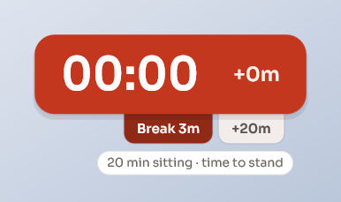

<p align="center">
  
</p>

<h1 align="center">Unseat</h1>

<p align="center">A tiny always-on-top sitting timer for Windows.<br>
The pill fills as you sit and turns red when it's time to move.</p>

<p align="center">
  <a href="https://github.com/flyingsatoshi/unseat/actions/workflows/ci.yml"></a>
  <a href="LICENSE"></a>
</p>

<p align="center">
  
</p>

<p align="center"><b>Time's up? Take a break, or sit one more session.</b><br>
  
</p>

<p align="center"><b>Docks to a screen edge.</b> Point at it to peek; it slides out when time is up.<br>
  
</p>

<p align="center"><b>Everything else is one click away in the tray.</b><br>
  
</p>

<p align="center"><b>Simple settings, light or dark.</b><br>
  
</p>

## Also

- Keeps counting through idle time, a locked screen and sleep; restarts pick up where they left off.
- Shortcuts: `Ctrl+Alt+Shift` + `P` pause · `B` break · `S` snooze · `R` reset · `U` show/hide.
- Optional iPhone reminders over your own Tailscale network ([setup](docs/iphone.md)).
- Five alert sounds, five sizes, countdown or stopwatch, 14-day stats.
- Local only: no account, cloud or telemetry. One 1.3 MB exe, no installer or runtime.

## Install

Windows 10/11 (x64). Download `unseat.exe` from [Releases](https://github.com/flyingsatoshi/unseat/releases), keep it in a folder of your choice and run it. Settings live in `%APPDATA%\Unseat`.

> 0.2, shown here, is not on Releases yet: take the `unseat-exe` artifact from the latest [CI run on main](https://github.com/flyingsatoshi/unseat/actions/workflows/ci.yml?query=branch%3Amain).

## Build

```bat
cargo build --locked --release --features gui
```

Needs Rust and the MSVC Build Tools. Tests, installing and benchmarks: [CONTRIBUTING.md](CONTRIBUTING.md). Design: [ARCHITECTURE.md](ARCHITECTURE.md).

## License

[Apache 2.0](LICENSE). Sounds [CC0](assets/sounds/LICENSE.txt), [Sora](https://github.com/sora-xor/sora-font) font [OFL 1.1](assets/fonts/OFL.txt). See [NOTICE](NOTICE). Forks may use the code but should not present themselves as the official Unseat.
