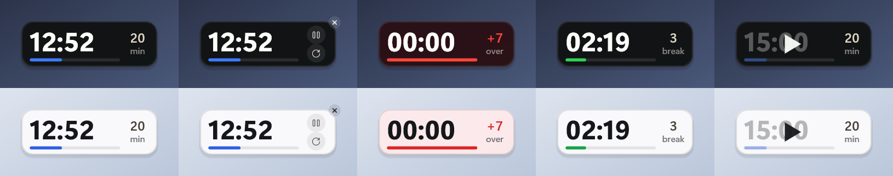
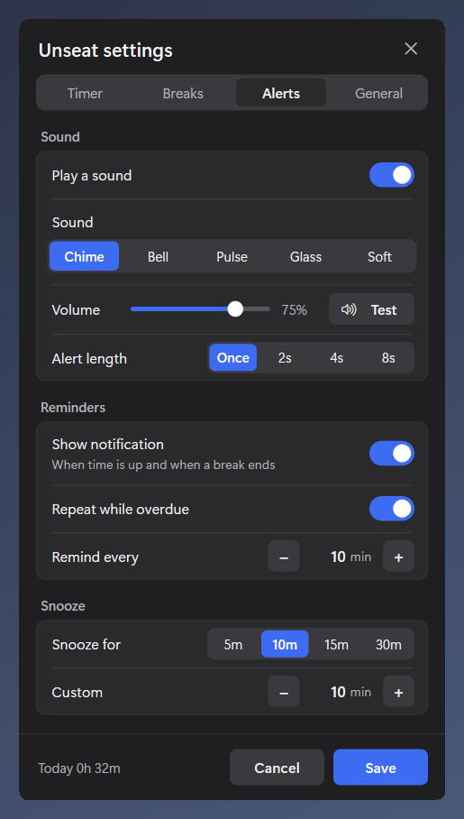
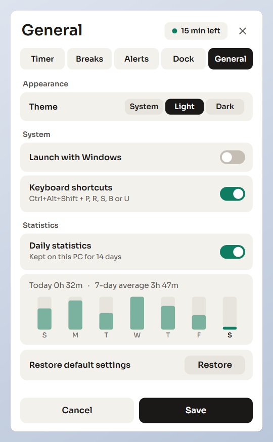
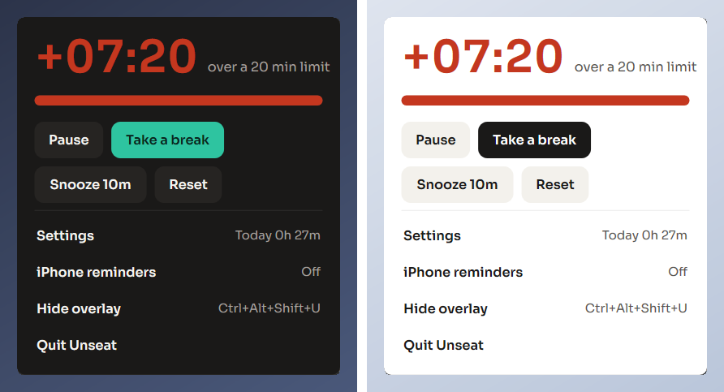
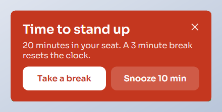
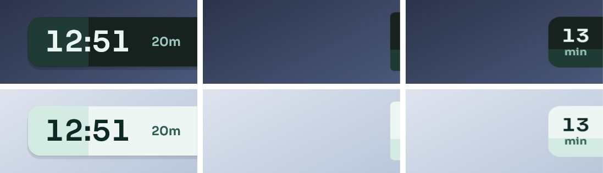
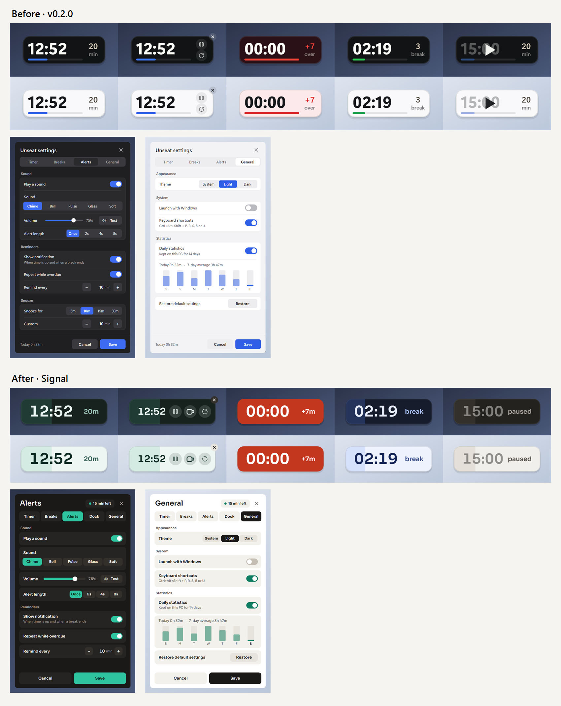

<p align="center">
  
</p>

<h1 align="center">Unseat</h1>

<p align="center">A tiny always-on-top <strong>sitting timer</strong> for Windows. The pill fills as you sit, turns red when it is time to move, and can tuck itself into a screen edge.</p>

<p align="center">No accounts. No cloud. No telemetry. One portable exe.</p>

<p>
  <a href="LICENSE"></a>
  <a href="https://github.com/flyingsatoshi/unseat/actions"></a>
</p>

<p align="center">
  
</p>

<p align="center">
  
  
</p>

<p align="center">
  
  
</p>

## What's new in 0.2

- **Signal design**: the overlay pill is the progress bar, its colour is the state, and the digits use the Sora typeface with fixed-width figures. Light, dark or system theme.
- **Keeps running** through idle time, a locked screen, sleep and a minimized overlay. Pausing when you step away is now an opt-in setting.
- **Edge docking**: attach the timer to any screen edge; it slides out to a slim progress tab and comes back when you point at it or when time is up.
- **Breaks** with their own countdown, a **time-up card** that asks *Break* or *Extend*, a **tray panel** instead of a plain menu, a volume slider, global shortcuts and optional weekly statistics.
- A new **Rise** icon.

<p align="center">
  
</p>

<details>
<summary>Before and after</summary>

<p align="center">
  
</p>
</details>

## Sitting timer for Windows

Unseat is a local desktop **timer** and break reminder. It stays on top of your work like a small watch, tracks how long you have been sitting, and alerts you when it is time to get up.

**Timing you can trust**
- Wall-clock based: idle time, a locked screen, sleep and a minimized overlay never stop it, and delayed updates never lose time
- Optional **Pause when inactive** (off by default): the overlay shows *away* while you are gone, and being away for the break length starts a fresh session
- **Break or extend**: when time is up, a card beside the overlay asks. *Break* counts down your break length, then a fresh session starts; *Extend* gives you one more full session
- **Breaks** any time from the overlay, the tray or `Ctrl+Alt+Shift+B`
- Reverse countdown or ascending stopwatch, without resetting the session
- Timer, pause and break state survive restarts; only Reset starts over

**Alerts that get noticed, not in the way**
- One alert at the limit, optional repeats while overdue that never pile up
- The time-up card waits for your answer (close it with x; click the overdue time to bring it back). While the overlay is hidden it asks once the overlay is back, and an optional Windows notification stands in
- Five bundled sounds, a volume slider and a Test button; every sound plays at the same loudness
- Short snoozes from the tray panel or `Ctrl+Alt+Shift+S`

**An overlay that fits your desk**
- The pill is the progress bar and its colour shows the state: sitting, near the limit, overdue, break, away or paused
- XS–XL sizes, optional always-on-top, drag anywhere (snaps to screen edges), position remembered on every monitor
- Optional **edge docking** with auto-hide, peek, pin and reveal-on-alert
- Tray panel with the countdown and one-click Pause, Take a break, Snooze and Reset

**Everything else**
- Light, dark or system theme; full keyboard navigation in settings
- Optional 14-day statistics with a weekly chart, kept only on this PC
- Optional launch with Windows

Settings live in `%APPDATA%\Unseat\settings.json`.

See [ARCHITECTURE.md](ARCHITECTURE.md) for how the engine and Win32 host split.

## Install

Download `unseat.exe` from [Releases](https://github.com/flyingsatoshi/unseat/releases), put it in a permanent folder of your choice (for example `%LOCALAPPDATA%\Programs\Unseat`), and run it there.

Unseat needs only Windows 10/11 (x64): no installer, runtime, Docker or developer tools.

> The latest published release is 0.1.1. Version 0.2 described here is on `main`; until its release is published, download the `unseat-exe` artifact from the latest [CI run](https://github.com/flyingsatoshi/unseat/actions/workflows/ci.yml?query=branch%3Amain) on `main` (needs a GitHub sign-in), or [build it from source](#build-from-source). Unseat is portable: it does not copy or relaunch itself, or create shortcuts automatically. You can pin it to the taskbar or create a shortcut yourself.

Close from the taskbar or tray **Quit**. Click the pinned icon to open it again. Hide the overlay from the close chip or tray; the timer keeps running.

Optional: Settings → General → Launch with Windows. This is off by default; the startup registration changes only when you change that switch and save, and the switch shows the real state (including an entry disabled in Task Manager). When it is on and you move the executable, the next launch updates the startup path.

## Shortcuts

Global shortcuts (Settings → General → Keyboard shortcuts, on by default). Shift is included so they never collide with AltGr typing; a combination another app already owns is left alone.

| Shortcut | Action |
| --- | --- |
| `Ctrl+Alt+Shift+P` | Pause / resume |
| `Ctrl+Alt+Shift+R` | Reset |
| `Ctrl+Alt+Shift+S` | Snooze (default length) |
| `Ctrl+Alt+Shift+B` | Start / end a break |
| `Ctrl+Alt+Shift+U` | Show / hide the overlay |

In settings: `Tab` / `Shift+Tab` move focus, arrow keys change values and tabs, `Space` toggles, `Ctrl+Tab` or `Ctrl+1…5` switch tabs, `Enter` saves and `Esc` cancels.

## Edge docking

Settings → Dock → **Dock to a screen edge**, or with it on, drag the overlay against any edge of any monitor. Docked, it waits **Hide after** seconds (3 by default) once the pointer leaves, then slides out to an 8 px tab whose fill shows progress. Point at the tab to see the minutes left; click it or press `Ctrl+Alt+Shift+U` to slide it in. When time is up it slides in on its own for **Stay revealed** seconds (choose time up only, all alerts, or never). The pin on the hovered overlay (or turning off **Slide out when not in use**) keeps it open. It stays clear of the taskbar, stays hidden while a fullscreen app has the monitor, remembers its edge and position, and follows monitor and scaling changes. The timer never pauses while it is hidden.

<p align="center">
  
</p>

## Upgrading from 0.1.x

Settings are kept. Earlier versions paused the timer during inactivity by default; that stored default is migrated to the new keep-running behavior once. Turn on **Pause when inactive** under Breaks to get the old behavior back.

## Alerts, break or extend, and snooze

Settings → Alerts picks **Chime**, **Bell**, **Pulse**, **Glass**, or **Soft**, a volume (75% by default, a little louder than before), and **Test**. **Once** plays the clip; **2s / 4s / 8s** loops it for that long. Repeat reminders fire on the interval you set and never stack: after sleep only one plays. A new sound always stops the previous one.

When the sitting limit is reached, a card beside the overlay asks **Break** (your break length, Settings → Breaks) or **Extend** (one more full session). It stays until you answer, shows even with Windows notifications off, and closes by itself if the session ends another way, such as a long absence with **Pause when inactive** on. Closed it? Click the overdue time on the overlay to ask again.

For a shorter delay, snooze **5 / 10 / 15 / 30** minutes or a custom duration (Settings → Breaks) from the tray panel or `Ctrl+Alt+Shift+S`. The last choice is saved.

## Build from source

Windows 10/11 x64, [Rust](https://rustup.rs/), and the MSVC Build Tools C++ workload including the Windows SDK/resource compiler. Docker is not needed.

Cargo finds the Build Tools by itself; an x64 Native Tools prompt works too:

```bat
cargo test --locked --all-targets
cargo build --locked --release --features gui
```

The binary is `target\release\unseat.exe`. It links the C runtime statically (`.cargo/config.toml`), so it runs on any Windows 10/11 PC without the Visual C++ Redistributable; CI checks that it needs only Windows' own DLLs. To run it day to day, install it instead:

```bat
powershell -ExecutionPolicy Bypass -File scripts\install.ps1
```

That builds, closes the running Unseat, copies the build to `dist\unseat.exe`, points an existing **Launch with Windows** entry there and starts it. Settings, statistics and iPhone pairing in `%APPDATA%\Unseat` are kept. Rerun it after every change.

- `-Exe path\to\unseat.exe` installs an exe that is already built, such as a release or the `unseat-exe` CI artifact. It needs no Rust, build tools or Docker.
- `-Docker` is optional. It cross-builds in a Rust Linux container when local builds are blocked, for example by Smart App Control (`os error 4551`). The container is limited to 4 CPUs and 6 GB (`-DockerCpus`, `-DockerMemory`) and keeps downloaded crates in the `unseat-cargo-registry` volume. The exe it makes also needs only Windows.

Builds under `target\` never register themselves to start with Windows, and opening a newer build while an older one runs replaces the older one.

End-to-end tests drive the real executable (idle, lock, sleep/resume, minimize, restart, migration, sizes, monitors, tray, startup entry, shortcuts). They run an isolated test instance beside any Unseat you already have open, with its own settings folder and startup value:

```bat
powershell -ExecutionPolicy Bypass -File scripts\test_app.ps1
powershell -ExecutionPolicy Bypass -File scripts\capture_screens.ps1
powershell -ExecutionPolicy Bypass -File scripts\measure.ps1 -Exes target\release\unseat.exe
```

Library tests do not need the GUI feature. The Win32 host is behind `--features gui`.

GNU builds additionally need MinGW `windres` on PATH (or configured through the resource compiler's `RC` environment variable). GUI builds require resources and fail if they cannot embed the application manifest, icon, and version information.

For release signing and handling antivirus false positives, see [Windows distribution](docs/windows-distribution.md). Build/test success does not establish an antivirus verdict.

To regenerate the icon (`scripts\make_icon.ps1`) or alert WAVs (optional):

```bat
python scripts\gen_sounds.py
```

## Privacy

Unseat never phones home. It does not upload usage, crash reports, or identity. Today’s total and the optional 14-day history are stored only on this PC.

## License

[Apache License 2.0](LICENSE). Contributions are accepted under the same terms. Alert sounds in `assets/sounds/` are [CC0](assets/sounds/LICENSE.txt). The embedded [Sora](https://github.com/sora-xor/sora-font) typeface is under the [SIL Open Font License 1.1](assets/fonts/OFL.txt). See [NOTICE](NOTICE) for third-party notes.

**Unseat** is a name of this project. Forks may use the code; they should not present themselves as the official Unseat app.
